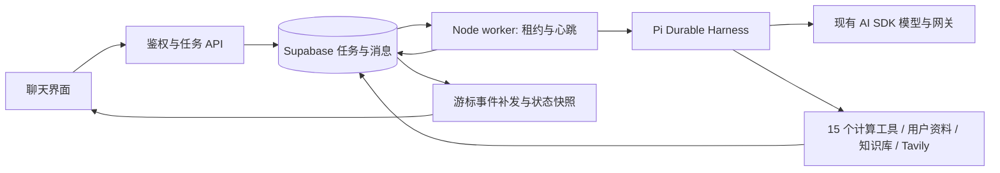

# 太卜 Agent

`/chat` 在 Agent 开关开启、worker 在线时默认进入 Agent；新对话可在输入框工具栏切换「Agent／对话」，已有 Agent 对话在模型菜单中切换。运行中的任务可以补充信息、调整方向、排队续问和停止。关闭页面不会停止任务；再次打开同一对话会恢复服务端状态并重连。

## 运行链路



执行内核固定为 `@earendil-works/pi-durable@1.1.0`，配套 Pi AI／Chord／MCP 同版本；仅接受 V2／`pi-durable/1.1.0` 检查点，旧 Pi 1.0.4 与 V1 执行兼容已删除。使用原生 Harness、GenerationTask、ToolTask、CompactionTask、请求去重和队列；模型桥接继续经过 `pi-stream.server.ts` 的 AI SDK，复用模型配置、网关排序、来源切换、推理和采样配置。开始输出后不会重新切换来源。模型和摘要权限在服务端重新校验，SDK 错误不会打印上游凭据。Durable 目前是实验接口，版本固定，并用官方存储契约测试检查适配器。

没有任务步数、检索次数或总运行时长上限。结束条件是模型完成、`ask_user` 等待补充、用户停止或不可恢复错误。外部请求仍有单次超时。Durable 按已配置的模型窗口选择完整工具回合的压缩边界；未知模型使用 Pi 的 `contextWindow: 0`，跳过容量阈值判断，在可识别的供应商超限错误后尝试一次压缩恢复。摘要通过原生 `HookApi.models` 调用同一个受控目录及 AI SDK 网关，保留权限、来源回退、请求超时、最近消息、成果 ID 和实际来源；摘要与真实用量原子保存。完整原始记录保留在 Durable 提交日志中。

管理员模型配置支持 `minimal / low / medium / high / xhigh / max` 六档默认思考等级。兼容网关参数格式沿用 `reasoning.effort` 或 `reasoning_effort`；现有 SDK 适配器负责转发其验证器未接纳的 `max` 和供应商扩展。需要应用 `20261009_120000_ai_reasoning_effort_levels.sql` 扩展数据库约束。模型、消息、工具、流式模式和输出预算由原请求流程管理。

Pi 1.1.0 适配涵盖十一体系命盘、六档推理、时间投影与当前引擎的 worker 崩溃接管。当前引擎策略、协作方式及验收边界见 [Pi 1.1.0 升级说明](../agent-pi-durable-1-1-upgrade.md)。

## 工具与成果

15 个计算工具直接复用 `taibu-core/mcp` 的定义、输入校验、引擎及规范 JSON／文本输出。工具结果按业务任务、Durable ToolTask ID 和模型调用 ID 暂存；随机种子从这个稳定标识产生。重启重放同一 ToolTask 会复用结果，模型在不同回合重用调用 ID 会生成不同工具任务。只有具备幂等缓存的业务工具声明安全重放。

11 份解读 guide 在构建时嵌入，与 skill 共享唯一映射。模型先看到按当前工具集过滤的简短体系目录，需要时使用 `load_analysis_method` 读取完整指引；工具名或旧 guide ID 均可加载。计算仍由 Core 完成，方法包不增加执行权限。参数准备只归一化确定的表示错误，错误出生时刻和历法会被拒绝。

多个体系资料完整时可调用 `parallel_analysis` 并行分析，子会话只提供该体系的计算及方法工具，禁止再嵌套。父任务汇总、选择成果，整体扣一次积分。子分析重启复用原生收据，并用 `{ at: receipt.answer }` 读取回答时的完整原生上下文；截断回答不能当作完整子分析。早报也复用该定点读取。用量面板累计父子模型请求、工具及压缩摘要的 token，不显示未经配置的金额。

输入框的模型菜单可启用多模型协作，配置 2–4 名成员的名称、模型、推理档位和分工。每名成员使用管理员目录中的独立模型（包含配置的自定义网关），主模型安排各成员分析并汇总分歧和结论；界面展示各成员模型、进度与可展开分析。创建任务前和每次模型调用都校验权限，配置在任务创建时冻结，整体仍计一次费用。成员独立 BYOK 密钥暂未提供；切换自定义直连主模型时按单模型启动，平台协作配置仍保留，供切回平台模型时使用。

`ask_user` 在原生 ToolTask 中提交问题 memo 后等待，外层任务进入 `awaiting_input` 并关闭当前 Harness。补充输入进入同一 Durable 队列，回复 memo 落库后恢复该 ToolTask；不创建新业务任务，也不再次扣费。正常进程退出和租约故障关闭 Harness，保留待恢复任务；用户停止则写入原生 abort 并等待工具结束。

个人命盘、历史、个性化档案和知识库使用已有服务。工具注入当前任务所属用户，并在每次执行及缓存重放前直接读取会员和功能开关；配置读取失败拒绝执行，不复用宽松缓存。模型回合和压缩摘要也遵守这一规则。知识库 RPC 绑定当前租约的用户，查询结束后恢复管理员会话的 JWT 上下文。普通会员的联网、Plus/Pro 知识库和 Pro 向量权限保持现有规则。

Tavily 工具按需检索，返回标题、摘要和 URL；来源卡片仅使用实际返回的 HTTP(S) 来源。用户可关闭联网。附件提取复用现有 Dify 流程。网页、用户资料和工具返回都作为资料处理，不能改变工具权限。

Agent 在最终答复前通过 `select_final_artifacts` 选择成果，支持空选择。成功完成时一次事务保存聊天消息并复用或新增标准八字／紫微命盘，**不自动新建命理记录**。无法转换为原生命盘的计算口径及规范工具结果保留在聊天过程和 Durable 日志中。命盘身份仍包括时区与 DST 策略。已有资料的修改、删除通过原有界面进行，历史分析记录和链接保留。

## 持久化与结算

迁移 `20261005_100000_agent_runtime.sql` 提供六张业务运行表；`20261005_120000_agent_chart_identity.sql` 更新命盘身份与去重；`20261006_100000_agent_pi_durable.sql` 增加 `agent_durable_commits` 和 worker 引擎标识；`20261009_100000_agent_pi_durable_1_1.sql` 升级引擎代际，随后 `20261010_100000_agent_current_engine_only.sql` 收紧为仅接受当前版本。活动旧任务通过原有结算函数终止、撤销租约及清理凭据，依原规则最多退款一次；已完成历史和成果保留。安全对象显式设置 `search_path` 和执行权限。原生日志只由受租约保护的管理员 RPC 读取／提交，普通用户不能直接读取或写入。公开消息修改仍受活动任务保护。

任务状态：`queued → running → awaiting_input / completed / cancelled / failed`，停止过程使用 `cancelling`。租约每秒续期，失效窗口为 60 秒；新的 worker 接管时递增执行版本，旧版本不能写入。每个业务任务对应独立的 Durable Storage，只允许当前租约进程推进。RPC 原子保存原生写批次及业务检查点，连续序号和相同批次去重保证丢失响应可重试；指令在原生 submission 进入 placed 状态时才被确认消费。结果不明时暂停当前执行并由新持有者重读日志。

存储适配复用 Pi MemoryStorage 的提交校验、索引、文档历史和分叉语义，先提交 PostgreSQL 日志，再应用已确认批次。重启分页重放日志后由 Harness 接续原生任务。这与官方 JSONL 后端一样会把当前任务的索引和历史保存在进程内存中，日志随任务长度增长；上下文压缩不会删除原始记录。大规模部署应监测单任务内存及日志增长，后续可替换为通过相同契约的 SQL 查询后端。

当前 V2 检查点由同版本 Durable worker 恢复；拒绝旧版本、缺失代际和未知引擎。历史聊天消息仍可阅读，但不能恢复旧执行日志。回滚应用前应停用新任务入口并完成当前任务，保留新增表与列。

命盘保存、业务任务状态、最终消息及完成事件仍由原有结算事务一起提交，保存成功而响应未到不会重复生成成果。`20261007_100000_agent_chat_results.sql` 将选定命盘保存与 MingRecord 分开；RPC 保留旧 `p_record` 参数以兼容旧 worker，但不再消费该参数。SDK 必须提供有效结束事件；异常 EOF、超时或 abort 会进入失败／停止路径，保留已显示正文。worker 退出及租约故障仍保留原生待恢复任务。

创建使用用户和 `clientRequestId` 去重，相同 ID 携带不同内容返回 409。活动对话只允许一个任务。指令接受和任务结算使用同一行锁：在最终回合落库前收到的指令会继续执行，再保存最终成果。

`20261006_110000_agent_lifecycle_fixes.sql` 在每次编辑／重新生成前更新当前版本槽位的正文、Agent 信息及完整后续消息，支持切回旧分支后再编辑。复用现有 JSON 版本和积分账本，不新增表或字段，也不回填已丢失的旧分支。该迁移同时阻止删除存在活动任务的对话（直接 DELETE 和图删除 RPC 均受保护）；先停止任务，等待结算完成，再删除。它追加于 Pi Durable 迁移后，保留原有结算与退款函数。

托管模型在创建事务中扣 1 次积分，自定义模型不扣。补充、调整、排队续问和恢复共用任务。失败／停止时没有可见正文且没有保存成果则退款一次；有正文或成果则保留扣费。新请求在上一任务结束后创建新任务。

BYOK 沿用浏览器的自定义模型界面，启动时将密钥提交给服务端，使用 AES-256-GCM 保存任务副本，AAD 绑定用户和任务。密钥不写入消息、事件、检查点、日志或响应。等待补充时保留副本，完成、失败、停止时删除。自定义服务必须是公开 HTTPS 地址；socket DNS 解析拒绝私网、保留地址和混合解析结果，并拒绝重定向。平台网关使用管理员管理的配置。

## 启动与配置

Node 需要 `>=22.19`；Docker 使用现有 Node 24 镜像。

```bash
pnpm install
pnpm dev                 # Web
pnpm agent:worker        # 另一终端：构建 core/worker 并启动后台执行
```

生产构建 `pnpm build` 会生成 `.agent/worker.mjs`。在与 Web 使用相同运行环境的常驻进程中执行：

```bash
node .agent/worker.mjs
node .agent/worker.mjs --check   # 仅验证构建加载，不访问数据库
node .agent/worker.mjs --health  # 检查最近 30 秒内的 worker 心跳
```

构建会将 Core 的公开包与运行依赖一并放入 `.agent/node_modules`，保持计算引擎的模块边界。worker 的外部 Next 服务端入口由 Docker runner 携带，并在镜像构建时执行 `--check`。新增依赖的许可证随 `.agent/licenses` 打包，Pi 原始 MIT 许可证保存在 `licenses/pi.LICENSE`。模型请求和摘要的单次超时为 5 分钟，Agent 数据库 RPC 为 30 秒，BYOK 连接与检索另外使用各自的请求超时；它们不限制任务总时长。租约续期从启动开始，覆盖长日志重放阶段。

Web 和所有 worker 需要相同的 Supabase URL、anon key、系统管理员账号、模型密钥和任务加密密钥。新增变量见 `.env.example`：

| 变量 | 用途 |
| --- | --- |
| `TAVILY_API_KEY` | Tavily 搜索；为空时不提供联网工具 |
| `AGENT_CREDENTIAL_ENCRYPTION_KEY` | 32 字节标准 Base64；BYOK 后台任务必需 |
| `AGENT_WORKER_CONCURRENCY` | 每个 worker 并发，默认 2；不限制任务长度 |
| `AGENT_MCP_SERVERS` | 可选 JSON 服务配置，公开 HTTPS 地址、唯一名称、工具白名单和可选 `tokenEnv`；最多四个服务 |

MCP 工具只在用户开启联网且会员允许时提供。worker 需要管理员列出的 token 环境变量；Docker 用私有 Compose override 显式传入这些变量。服务返回内容是资料，服务器指令不加入任务指令。DNS 解析拒绝私网和混合地址，重定向被拒绝；外部副作用不自动重放。

使用 `openssl rand -base64 32` 生成任务密钥，在秘密管理中设置并备份。所有 worker 必须一致；轮换前先结束已有 BYOK 任务。功能开关沿用管理中心的 `feature_disabled:agent`。`GET /api/agent/status` 向登录用户返回功能、worker、联网及加密服务可用状态，未就绪时界面保留普通对话入口。

Docker runner 同时包含 Web 和 worker 构建，可使用同一镜像的两个服务：Web 默认命令为 `node server.js`，worker 命令为 `node .agent/worker.mjs`。`docker-compose.local.yml` 和 `selfhost up` 提供 worker 与健康检查。固定 3196 测试栈支持本次经哈希审定的增量迁移；其他未知基线继续拒绝，禁止重放初始化。

线上迁移按仓库规范通过 Supabase MCP 执行。完整空库自托管基线包含该迁移；已有自托管数据库只应用增量迁移，不重放空库基线。

## API 与事件

| 请求 | 用途 |
| --- | --- |
| `POST /api/agent/runs` | 创建任务；拥有的 `conversationId`、`clientRequestId`、用户消息及模型配置 |
| `GET /api/agent/runs?conversationId=…` | 读取对话的最近任务 |
| `GET /api/agent/runs/:id` | 读取拥有的任务快照 |
| `GET /api/agent/runs/:id/events?after=…` | SSE，补发游标后的事件再发送一致的完整快照 |
| `POST /api/agent/runs/:id/messages` | `reply / steer / follow_up`，指令也使用 `clientRequestId` 去重 |
| `POST /api/agent/runs/:id/cancel` | 请求停止；等待 worker 安全结算 |
| `GET /api/agent/activity` | 对话侧栏的任务标记：本人执行中／等待回答的任务与未读任务通知 |

公开快照包含任务状态、`cursor` 和版本 1 的聊天消息。消息包含有序正文、推理、工具、问题、来源、成果部分，并生成普通消息可读的 `content`。原生模型响应测量保存在 `runtime.responses`，工具部分保留 `durationMs / startedAt / endedAt`，历史字段缺失时不补造数据。SSE `history` 事件重放持久化事件，`snapshot` 提供当前完整公开状态；连接中断、刷新或浏览器关闭均不会取消任务。

SSE 继续兼容 v1 游标，并提供 worker `epoch`。执行版本变化、游标超前或缺少事件时发送 `resync` 和完整快照。事件序号为全局序号，不要求单任务连续。服务端待发送数据上限为 8 MiB，慢连接关闭后浏览器重新读取快照；浏览器 30 秒无数据会断开重连。

个性化设置可管理最多 20 个问法模板及默认关闭的长期记忆。输入框“问法模板”按钮将当前问题代入 `{{question}}`；模板和语音都只填入草稿。语音按钮使用浏览器识别服务，可能联网；用户编辑草稿后识别结果不会覆盖已有内容。新迁移 `20261008_180000_agent_competence.sql` 提供记忆表及 owner/来源/租约约束，用户可查看、手动保存和删除，关闭开关不删除记录。Agent 仅摘录明确表达的原话，不能保存模型推断。

早报通过受限原生 Agent 读取黄历和已存命盘，沿用既有 job 的一次预占、成功结算及失败退款。独立评测入口、实现与验证记录见 [域能力补全说明](../agent-domain-competence-implementation.md)。

快照还包含创建请求标识与公开用户消息。浏览器对丢失响应及服务端故障使用相同创建请求重试，在结果不明时保留请求标识并查找已接受的任务。补充／排队指令的自动及手动重试也保留原内容、模式和请求 ID，即使等待态已恢复。等待补充期间 SSE 继续订阅，其他标签页恢复或停止任务会更新当前界面。所有异步回包绑定用户登录周期和对话选择周期；发送成功仅清理提交后未更改的草稿，保护新的输入、引用和附件。旧任务的迟到快照不能替换新任务；恢复状态、同步历史版本期间锁住输入和历史操作。新的计算或追加指令会重新要求确认最终成果。

Pi 原生语义与宿主边界：`submit(requestId)` 是持久化收据去重，宿主必须重用原 ID 和完整内容；`placed` 表示输入已被采用，`done` 才表示已回答。`Harness.close()` 保留可恢复工作，`Conversation.abort()` 持久化停止请求。`ask_user` 在同一 ToolTask 内使用问题／回复 memo。模型流的 `end()` 只关闭事件流，成功由正常 `done` 事件与 stop reason 决定。观察器停止后还须等待已开始的投影回调，再提交最终状态。聊天版本由现有消息 JSON 管理，每个业务任务拥有独立原生日志，不用原生 fork 代替聊天版本。

## 本次变更范围与验证

分支 `codex/agent-chat` 从 `5725dde` 创建，保留原有工作区改动。Agent 新增范围是 `src/lib/agent`、`src/app/api/agent`、Agent 消息组件、迁移及专项测试；集成改动集中在聊天 hooks／界面、AI SDK 适配、知识库持久化注入、功能开关、消息类型、成果入口、worker 构建／部署配置和 schema 文档。已有 core 算法、自托管及其它未提交改动保持独立。

| Agent 变更组 | 文件范围与集成点 |
| --- | --- |
| 执行与安全 | `src/lib/agent/*`：Pi 适配、工具、检查点、租约、凭据、目标地址校验、浏览器重连 |
| 接口 | `src/app/api/agent/*`：状态、创建、读取、事件、指令与停止 |
| 聊天 | `AgentMessage.tsx`、聊天 layout／composer／message／hooks、`src/types/index.ts`：模式切换、有序部分、任务恢复、历史版本 |
| 现有服务 | AI SDK provider 导出复用入口、知识库 search 注入持久化权限、`app-settings.ts` 功能开关、records 页面成果入口 |
| 数据库 | Agent 运行、命盘身份、Durable 和生命周期四份迁移、schema 快照、自托管空库生成器与数据库合同测试 |
| 运行与部署 | `scripts/agent-worker.mjs`、`scripts/build-agent-worker.mjs`、Dockerfile／Compose、selfhost worker 就绪检查、Pi 许可证 |
| 验证与说明 | `src/tests/agent-*.test.ts`、`scripts/tests/agent-*.mjs`、环境变量、架构及部署文档 |

表中已有文件仅记录 Agent 集成部分，不将整份文件的既有修改归入 Agent。开始前保存了 HEAD、工作区／暂存区 diff 与状态快照，位置为本机临时目录 `taibu-agent-baseline-fk9fpljn`。

验收期间对既有紫微改动中的一处未闭合函数调用补齐了右括号，仅作为语法修复；没有重写其算法。Docker 原有 `taibu-local` 服务和数据未修改。每次隔离建库使用新的项目名与端口；对已有验收栈更新应用代码前，核对初始化 SQL 正文、限流增量和 Storage SQL 完全一致，不重放基线或修改数据库版本标识。

```bash
pnpm test
pnpm lint
pnpm typecheck
pnpm build
pnpm test:db
pnpm test:auth
node scripts/tests/agent-selfhost-browser.mjs --project <独立演示项目> --chrome
```

专项检查覆盖超过常见循环阈值、摘要、缺信息暂停后继续、缓存结果恢复、截断参数、接口权限、AES-GCM、DNS/重定向、SSE 重连、扣费／退款、租约接管、晚到指令、保存和事件的原子性及命盘复用。浏览器验收使用独立的自托管数据库和确定性离线模型，真实经过 Next API、AI SDK、Pi、worker 和保存流程；这不代表真实模型的推理质量或 Tavily 外网可用性。真实联网和线上 Supabase MCP 迁移需另行配置验收环境。

### 2026-10-05 Core 基线本地隔离验收结果

| 检查 | 结果 |
| --- | --- |
| `pnpm test` | 1400 / 1400 通过，0 跳过 |
| `pnpm test:db` | 41 / 41 通过，0 跳过 |
| `pnpm test:auth` | 21 / 21 通过，0 跳过 |
| `pnpm lint`、`pnpm typecheck`、`pnpm build` | 全部退出码 0 |
| `node .agent/worker.mjs --check` | worker 构建及运行依赖加载通过；Docker 镜像构建也执行同一检查 |
| 生产浏览器端到端 | 6 个真实任务通过，0 外部请求、0 服务端 5xx、0 页面运行时异常 |

运行单测实际执行了 37 轮模型调用和 35 次八字计算，验证任务不会被常见默认循环阈值截断。浏览器使用项目 `taibu-agent-verified-1005` 与独立数据库，覆盖跨命盘、最终保存与成果入口、重复提交、编辑与重新生成、补充后续跑、刷新恢复、移动端、停止退款及普通对话。通过强制终止 worker 再启动验证 60 秒租约过期后的接管，已提交计算未重复执行，分析未重复保存，积分仅扣一次。

截图保留在该项目私有目录中的 `agent-acceptance.png` 与 `agent-mobile-acceptance.png`。临时开发服务器及三个本次验收项目均已停止，隔离卷保留；Agent 验收镜像保留为 `taibu-web:agent-verified-1005`。原有 `taibu-local` 容器持续运行且健康，`taibu-web:local` 已恢复到其原始镜像，避免影响后续重启。

既有问题：原始镜像 `8cd4056e484f` 的匿名 `/chat` → `/records` 导航也间歇出现 React hydration #418。该告警可由原有版本独立复现；最后一轮 Agent 完整浏览器验收没有出现。后续页面渲染维护应单独跟踪这一问题。

真实 Tavily 联网、真实模型推理质量及线上 Supabase MCP 迁移尚未执行，按本次要求保留为外部环境验收项。当前交付是工作区实现与本地验证，没有提交或部署。

### 2026-10-06 Pi Durable 切换验收

直接依赖已替换为 Pi Durable／Pi AI／Chord 1.0.4，移除 Pi Agent Core。Web 的历史转换与 worker 执行模块分开，任务消息格式仍为 V1，原生检查点为 V2；新增迁移和空库基线保持原子积分／保存事务。

| 检查 | 结果 |
| --- | --- |
| `pnpm test` | 1459 / 1459 通过，0 跳过 |
| 原生执行专项 | 20 / 20 通过：37 轮模型、35 次计算、分次补充、旧任务迁移、恢复与请求超时 |
| 存储适配 | 官方 23 项存储契约，加分页重开和丢失收据检查，共 25 / 25 通过 |
| `pnpm test:db` | 43 / 43 通过：提交／检查点原子性、消费确认、混合 worker 与租约隔离 |
| `pnpm test:auth` | 21 / 21 通过；使用真实 GoTrue／PostgREST |
| `pnpm lint`、`pnpm typecheck` | 退出码 0 |
| Docker 中的 `pnpm build` | 生产 Web／worker 构建通过；主机与 Linux 镜像中的 worker `--check` 均通过 |
| 浏览器复跑 | 6 个任务及普通对话通过，外部请求、5xx、页面运行时异常均为 0 |

浏览器通过真实终止 worker 验证 60 秒租约接管、缓存计算不重做、一次扣费及一次保存。第一轮仍捕获既有 React hydration #418，第二轮完整严格验收为 0 异常；保留这一既有问题的独立追踪。截图位于私有项目 `taibu-durable-1006` 的验收目录。

最终镜像再次通过完整严格浏览器验收，保留为 `taibu-web:agent-durable-1006`（`sha256:68b467e860901f0943b2ac7f780b4eecfca579ccebd00ef34b794058100a7b9e`），已核对包含旧问题迁移、启动阶段续租与 RPC 超时。隔离栈停止，卷与截图保留；原有 `taibu-local` 服务不变，共用 `taibu-web:local` 恢复到原始镜像。

主工作区 `.next` 被另一构建进程持有，使用独立 Docker 构建运行 `pnpm build` 并验证生产运行依赖，不删除或抢占对方构建锁。切换前另存了 `taibu-pi-durable-baseline-cn8qo3gv` 备份，保留原有未提交修改。真实外部验收和线上 MCP 迁移继续按用户要求延后。

### 2026-10-06 独立审查问题修复验收

修复限流返回值、SDK abort／异常 EOF 结算、重复编辑的分支尾部保存、跨对话异步回包、等待输入订阅、命令重试收据、活动对话删除结算保护、草稿竞态与 fresh 权限检查。真实浏览器另复现并修复空对话缓存卡在 loading 的问题。全部在 `codex/agent-chat` 的隔离工作树完成，未提交、部署或执行线上迁移。

| 检查 | 当前结果 |
| --- | --- |
| `pnpm test` | 1471 / 1471，0 跳过 |
| `pnpm test:db` | 46 / 46，含连续编辑／旧分支再编辑，以及四种活动状态下删除保护和一次退款 |
| `pnpm test:auth` | 21 / 21，真实 GoTrue/PostgREST，临时资源已清理 |
| 离线浏览器 hooks 验收 | 95 项；含 A→B→A、等待输入跨标签页恢复／取消、丢失响应重试、草稿与同账号重新登录竞态；0 运行时异常 |
| lint、严格类型、Web／worker 构建、worker `--check` | 均通过 |

本轮浏览器为实际 React hooks 和受控 HTTP／SSE 边界，未复跑此前 Docker 生产浏览器端到端套件；外部模型、Tavily 和线上 Supabase 边界继续保留。增量迁移只在一次性数据库中验证，已有部署须应用 `20261006_110000_agent_lifecycle_fixes.sql` 才具备新的分支／删除保护。

### Agent 工作区界面

参考 [PI-Desktop 的工具展示与聊天布局](https://github.com/vastsa/PI-Desktop/tree/176e1cf7187855b7354cf5709f68a90fa5dab6a0/apps/desktop/src)，任务过程按连续工具／思考分组，显示步骤完成数、失败状态、参数和结果；完成后自动折叠，用户可自主展开。消息标题显示已完成模型响应的累计用时与次数；步骤显示实际执行用时，调用详情另列包含等待和恢复的执行阶段。刷新和历史恢复复用原生测量，旧记录没有数值时不显示。实时阶段投影自 Pi `pi.live`，区分等待模型、思考、工具执行、压缩与整理结果。输入区支持执行中「补充到当前任务」／「结束后续问」，中文输入法选字不会触发发送。

`ask_user` 等待时提问面板取代输入框，逐题回答后在「提交前检查」中提交。草稿按用户／对话／任务／问题 ID 隔离；「稍后回答」把面板折成一行并交还输入框，可直接在对话里回答，点击「回答问题」重新展开。提交沿用 `reply` 指令、同一任务及原扣费。刷新后从服务端问题恢复面板。

工具栏右侧、发送按钮左侧的模型菜单统一提供模型选择与推理档位；Agent 模式还提供分析风格、对话方式和多模型协作。模型菜单左侧的圆环显示上下文用量，点击查看计数。普通对话与 Agent 都保存会话级推理选择，关闭或无权限时不传档位。Agent 使用 Pi 的活动 transcript 和 `estimateContextTokens`：最近有效 usage 为已测基准，后续消息显式标为估算；压缩后旧基准失效。检查器区分已测／混合／估算、缓存读写、输出和压缩次数，SDK 缓存与推理子计数不重复加总。未知模型容量不套用 32k，不显示百分比；已知上限标为应用配置。普通对话继续使用原有提示预算。

八字、紫微、奇门、六爻、梅花、大六壬、小六壬、塔罗、太乙、西方占星和黄历工具成功后，任务过程下方出现一张紧凑命盘卡；任务过程折叠后仍能访问。「在工作区查看」在桌面宽屏打开右侧工作区，手机使用全屏查看；正在工作区显示的命盘，卡片标为「正在工作区显示」。没有工作区时（对话工作台之外），卡片改为「展开命盘」弹窗查看工具返回盘面。模型查看新的原盘时，桌面工作区会自动展开；同一任务中主动关闭后保持关闭。展示使用已持久化的实际工具结果，刷新和历史恢复不重新排盘、不保存第二份记录、不扣费；模型定位仅滚动工作区，保留用户的键盘焦点。字段不足或视图异常时保留规范文本。检索结果不再在聊天中逐条列出：步骤摘要显示检索词与命中数，回答末尾的「依据」打开工作区的回答依据。参数与原始结果在工作区「过程」的「第 N 步」调用详情中查看和复制；没有工作区时，点击步骤就地展开，失败步骤自动展开。

模型分析时，盘面显示当前主题与正在查看的位置，包括干支关系、宫位星曜、门星神、卦爻体用、四课三传、推演步骤、牌位、太乙星将、占星相位和黄历时辰。点击盘面中的实体会暂停跟随，任务执行期间点击「跟随模型」恢复；切换历史命盘保留各盘最近的模型焦点。「追问这里」保留现有草稿并附带原盘引用，用户发送后才创建任务，手机同时收起抽屉。具体目标与旧记录边界见 [全体系命盘联动说明](../agent-chart-interaction-review.md)。

点击右上角「工作区」查看当前对话。任务执行或等待回答时工作区以「过程」开头，任务结束后为「概览」与「过程」；其余内容按工具族成为标签（规则见下文 2026-10-10 界面落地，外框与概览见 2026-10-12）。工作区支持多资源标签并在当前会话恢复，关闭资源标签不会删除成果。历史记录链接继续可用；任务结束后未完成的工具不再持续转圈。仅显示当前消息分支的成果。

多轮对话采用统一内容列、按内容收缩的用户气泡与统一 Markdown 排版。任务内的补充回答通过任务关联显示在后续任务输出之前；刷新后仍恢复该顺序，旧会话可从任务快照恢复关联。消息的复制、编辑、重新生成、知识库归档及历史版本切换使用一致的操作区。上滚阅读或展开步骤后停止跟随新输出，点击「回到最新」恢复跟随；普通列表与长对话的虚拟列表共用阅读规则。

模型、上下文、输入工具、消息及会话菜单共用按视口翻转和收边的浮层，支持方向键、Escape 与焦点返回。命盘展开、确认、知识库选择和移动端抽屉共用原生模态对话框，键盘焦点留在弹窗内；抽屉内的会话菜单保留在同一顶层，Escape 先关闭菜单。桌面任务工作区支持拖动或方向键调整宽度。设置使用独立的 `/settings/<分类>` 页面，旧 `#settings/...` 链接自动转换；具体地址和草稿保护见 [界面与设置说明](../ui-settings-agent.md)。

输入草稿按账号与对话隔离，在当前标签页的刷新与切换中恢复文字、引用和联网选项。Agent 的私有图片与文本资料保存附件 ID，可在刷新后恢复；普通对话的临时提取文件仍仅驻留内存。退出或切换账号时清理前一账号的草稿。新对话建立后转移原草稿，发送成功只清理该次提交后没有继续编辑的内容。

本地固定测试入口为 `http://127.0.0.1:3196/chat`，项目 `taibu-agent-1006b`，更新使用 `pnpm local:update`。详见 [固定通用测试栈](Self-Hosting.md#固定通用测试栈3196)。

2026-10-07 本轮累计验收：最终全量测试 1494 / 1494、独立 PostgreSQL 契约基线 46 / 46（均无跳过），lint／架构检查、严格类型、生产 Web／worker 构建和 worker 加载检查通过。3196 生产容器浏览器验收完成 6 个 Agent 任务及普通对话，覆盖命盘复用、聊天分析、Pi 上下文与右侧控件、提问／设置／自定义模型弹窗的焦点循环和返回、任务补充回答顺序及旧会话刷新恢复、会话草稿、普通／虚拟列表阅读位置、嵌套菜单、工作区宽度、320px 布局、一次扣费／退款和真实 worker 崩溃恢复；未捕获外部请求、5xx、水合或其他运行时错误。模型为确定性的离线 demo，未验证外部供应商或真实联网。

### 五批体验与能力扩展

阅读区新增流式 Markdown 稳定块缓存、按需 Shiki、表格操作、小地图和统一消息定位；阅读列宽为 560–1200px，字号四档作用于全站 rem。工作区资源支持命盘、来源、工具结果和资料预览标签的切换、关闭、排序、键盘导航及会话级恢复。

输入区支持斜杠命令、全局对话搜索、历史召回和可撤销润色。Plus/Pro 默认每天最多五次润色实际调用，不扣积分。任务运行时修改的模型、推理、协作和联网等配置用于下一项任务；当前任务及其补充、续问保持原配置，下一个独立任务发送前重新校验权限。

提问工具兼容旧字符串，并支持有稳定 ID 的多问题、单选、多选、自填、跳过和提交前汇总。任务清单最多 50 项且最多一项执行中。未投递续问可编辑、撤回、排序或提前处理；领取后锁定，RPC 与 worker 共用任务行锁。停止后可将取消的续问恢复为草稿。分析方法按版本目录按需加载；压缩保留摘要、范围、位置及失败原因。来源切换和瞬态重试共享每次模型调用三次外部尝试，已有输出不重启；空答复最多恢复一次。

完成回答可分叉成独立对话，复制部分是只读历史，分叉不扣费或复制运行状态。导出 Markdown／可打印 HTML 默认包含当前分支正文、命盘依据和来源，工具详情由用户选择。Agent 图片每条最多四张、原始文件最多 10MB，限平台视觉模型；超过 8000 字符的纯文本粘贴自动转为私有文本资料。文件与消息、版本、队列和分叉通过 ID 关联，最后一个引用解除后才回收；未绑定文件 24 小时后回收。Durable 日志不保存 base64 或签名 URL。

任务完成、失败、等待补充生成幂等站内提醒；网页打开且用户主动授权后可使用桌面提醒。每日早报默认关闭，用户可设置时区和时间，默认当地 08:00；成功每天一份扣一积分。原子预占、租约、三次生成尝试、失败一次退款和独立通知投递复用现有 scheduler，以五分钟轮询恢复停机期间的当天工作。余额不足跳过当日。

增量迁移 `20261007_110000` 至 `20261007_190000` 与对应自托管基线必须先于 Web／worker 更新。应用通过普通 authenticated 系统管理员会话访问后台，新增表、RPC 和私有 Storage 均复用管理员权限边界。自托管更新完成后刷新 PostgREST schema 缓存；Sharp 原生依赖随 standalone 产物携带，镜像构建验证实际图片处理。`AGENT_ATTACHMENTS_ENABLED=false` 可关闭新上传，`DAILY_BRIEFING_ENABLED=false` 可关闭早报生成并退回未结算预占。具体完成与验收记录见 [实施记录](../agent-experience-implementation.md)。

### 2026-10-08 界面与自动命盘验收

设置已迁移到独立页面，命盘自动显示于工作流中并支持展开、固定与手机全屏。工作区复用已持久化的工具结果，按成果 ID 去重；查看和恢复不重新排盘、保存或扣费。

全量测试 1524 / 1524、组件浏览器回归 113 项、lint／架构检查和生产构建通过。固定栈 `taibu-agent-1006b` 的完整生产浏览器验收再次完成 6 个 Agent 任务及普通对话，含取消设置后退／前进／刷新、一次扣费／退款及真实 worker 崩溃接管；外部请求、5xx 和运行时异常均为 0。八种占术视图使用真实 MCP 输出验证，外部模型与真实联网仍未验收。详见 [界面、设置与验收记录](../ui-settings-agent.md#2026-10-08-验收结果)。

### 2026-10-10 架构复核与工具结果重构

复核 `src/lib/agent`、`src/app/api/agent` 与聊天 Agent 组件后，修正三处与工具结果相关的结构问题。不改数据库、迁移、计费、接口格式或 Durable 日志结构。

| 问题 | 修正 |
| --- | --- |
| `ask_user`、`todo_write`、`web_search`、`select_final_artifacts`、`search_knowledge` 先改检查点、后写 `agent_cache_tool`；同一副作用在执行与缓存重放两处各写一遍。缓存写入失败时会留下问题（任务误入等待补充）、已前进的清单版本（模型重试同一 revision 必然冲突）、来源或最终选择 | 副作用收拢为 `createAgentTools` 内按工具名登记的单一 reducer，只在缓存成功后执行，缓存重放复用同一函数；各工具的 `execute` 只校验并返回结果 |
| 工具名单散落：投影层的规范文本白名单只列了 8 种盘，漏掉太乙、占星、黄历，三者降级时显示原始 JSON；工具卡按名称片段猜图标，9 种盘显示通用扳手 | 新增浏览器安全的 `tool-catalog.ts`，统一盘种身份、工具族（命盘、推演、检索、资料、方法、计划、提问、协作、记忆、成果、外部）与规范文本判定；投影、命盘识别和工具卡图标都从此读取 |
| SSE 每秒为每个连接构建完整公开视图，空闲心跳也读取命令队列 | 先用任务行判断游标、执行版本和终态，只在需要发送快照时构建视图；帧序列、resync 与终态行为不变 |

新增 `agent-tool-effects`、`agent-tool-catalog` 与 SSE 心跳回归：缓存失败不留状态且同一 revision 可重试；新执行与缓存重放得到相同检查点、且不重复联网或写缓存；15 个 Core 工具与全部注册工具都有工具族；11 种盘经真实 Core 与原生投影后都保留规范文本；空闲心跳不构建视图。三组关键断言在旧实现上失败，在新实现上通过。

后续建议（本轮未实施）：`executeAgentRun` 仍是约 400 行的闭包，可按模型绑定、钩子、命令投递和结算拆成可单测的工厂；`ChatLayout` 与 `AgentWorkspacePanel` 的工作区状态（打开、自动展开、标签、跟随模型）分散在两个组件和四个 `sessionStorage` 键，宜下沉为一个 hook 并让工作区按工具族渲染视图；分叉与方法选择仍通过 `window` 自定义事件通信；`AgentQueue` 等组件整棵 JSX 写在单行，修改时宜先格式化。SSE 仍是每连接每秒轮询，规模扩大后可改为数据库通知驱动。

### 2026-10-10 Agent 与对话界面按设计稿落地

设计稿为本对话的 Design 画布「Taibu Agent 对话工作台」（Agent 执行中、等待补充、检索、协作、普通对话、空状态、任务完成、组件规范、工具视图与手机共 12 个画板）。本轮把右侧工作区和左侧对话列按稿落到代码，未改数据库结构、迁移、计费规则或接口路径。

**工作区按工具族渲染。** `src/lib/agent/workspace.ts` 从当前分支的已持久化 parts 推导工作区资源，每次工具调用对应唯一位置：同一命盘的计算、查看与定位合并为一个标签；检索合并为「回答依据」；同一记录、附件或方法各一个标签；任务清单进入「过程」，最终选择进入「成果」；MCP 与未登记工具显示参数与原始结果。视图位于 `AgentWorkspaceViews.tsx`：推演（大运时间轴并标出当前大运、四柱反推候选、紫微运限表、飞星结果，旁附 Core 规范文本）、回答依据（按检索顺序连续编号，只链接 HTTP(S) 来源，零结果说明检索词）、资料列表与记录、个性化档案、附件已读位置、版本化解读指引（注明不增加执行权限）、提问清单与已存回答、协作成员卡（实际模型、推理档位、分工、进度与结论）、长期记忆（确认后删除，按账号校验）。任一视图出错时改显示工具的规范文本。

**跟随与自动打开。** 「跟随模型」显示模型最近一次调用的工具对应视图，任务清单更新不会把视图拉走；点击盘面、步骤或标签即暂停。桌面宽度 ≥1280px 时，命盘、提问与协作三族的新事件打开工作区；用户关闭后本任务内不再自动打开。任务结束时仍未完成的步骤显示「已结束」，不再转圈；没有测量值时不补造用时。

**对话列。** 顶栏显示对话标题、Agent 标记与实时状态（含任务已执行时长），工作区变窄时依次隐藏次要入口，标题保持可读。消息头为「卜」头像、状态胶囊和模型响应用时；任务清单为一行进度（段条、当前步骤、「查看」打开工作区过程）；任务过程为单张卡片，每步显示状态标记、标题、摘要（检索词与命中数、资料数与不可读项、协作进度、问题数等）、用时和工具族标签，可展开调用详情，也可「在工作区查看」；八字卡片以五行着色的四柱缩略、日主与关系摘要和「在工作区查看」为首行；协作改为成员紧凑卡与「在工作区比较」；回答末尾的「依据 N」打开回答依据。模式与联网开关移到输入框上方，续问队列贴合输入框，执行中输入可「补充到当前任务」或「结束后续问」。空状态为按时段问候、四张带说明的建议卡与计费说明。提问面板保留模态焦点管理，位置停靠在输入框处，手机为底部抽屉。对话区与命盘弹窗内的五行色改为可读色并区分深浅主题，其他页面保持原色（`getElementColor` 返回带原色回退的 CSS 变量）。

**后端配套。** 投影层为大运、四柱反推、紫微运限和飞星保留 Core 规范文本；`remember_user_fact` 只返回记忆的 id、标题、正文、类型和更新时间，不再把 user_id、指纹或来源任务送入模型与对话；协作进度记录每名成员实际使用的推理档位与分工；任务视图返回结算后的计费状态（计费、免扣或已退还）。

**测试。** 新增 `agent-workspace`（资源归并、跟随、自动打开、问答关联与各族解析器，使用真实 Core 结果）、`display-helpers`，并扩充 `agent-presentation`、`agent-tool-catalog`、`agent-tool-effects`、`agent-domain-features` 与 `agent-api`。浏览器组件验收新增工具族视图、跟随切换、计划不抢焦点、未完成步骤停转、依据编号与非 HTTP 链接过滤、过程步骤跳转、协作成员档位、外部工具复制、记忆删除确认与账号校验、计费摘要、依据胶囊与协作比较等检查。

**验证。** 全量测试 1613 / 1613（无跳过）、浏览器组件验收 176 项（无外部请求与运行时异常）、lint 与架构检查、严格类型检查、Agent worker 构建与加载检查、Next 生产构建均通过。另用编译后的应用样式渲染真实 `ChatLayout` 与工作区，逐板对照设计稿检查执行中、完成、空状态、深色主题与 390px 手机布局。本环境未运行需要 Docker 的 `pnpm test:db` 与 3196 固定栈的 Agent 实机验收（`agent-*-browser.mjs` 中随本轮改名的按钮文案已同步）。

**本轮未做。** 全局侧栏（会话分组、待回答标记）仍沿用现有导航；回答正文中的引用编号与依据卡双向定位、协作分歧对照表和完成后的追问建议需要模型输出结构化数据，未实现；手机工作区仍为全屏对话框，未做底部标签抽屉。

### 2026-10-11 顶栏、输入框与提问面板按设计稿复刻

上一轮落地后，顶栏、输入框、空状态和提问面板的尺寸、文案与层级仍与「Taibu Agent 对话工作台」画板有出入。本轮逐项对照画板复刻这四处，未改数据库结构、迁移、计费规则或接口路径；`/api/models` 只新增只读字段。

**顶栏。** 高 56px。点击标题可重命名、导出或删除对话；协作任务的标记为「Agent · 协作 N 人」。状态依次显示「后台执行中 · 用时」「协作分析 x / n」「等待你回答 · 任务已暂停」。「工作区」按钮附成果数；「更多对话操作」收纳新建对话、导出、个性化、知识库和阅读列宽。普通对话保留独立的「导出」按钮。默认阅读列宽按画板改为 700px。

**输入框。** 单一圆角外壳。工具栏依次为「+」（上传资料、普通对话联网、知识库、问法模板、语音、润色）、@ 引用、「Agent／对话」切换、按需联网、上下文圆环、模型菜单和发送／停止。新对话与普通对话的模式切换在工具栏，Agent 对话的移入模型菜单。执行中有草稿时显示「结束后续问」「补充到当前任务」和小号停止。输入框下方的说明随状态变化，由 `composer-copy.ts` 给出。积分用完时，输入框上方提示「积分已用完」并链接「获取积分」。空状态包含：
- 「卜」字与按时段问候；
- 大号输入框；
- 已存命盘快捷引用（最多 3 个）与「+ 新建命盘」；
- 四张建议卡与「问法模板」入口。

**模型菜单。** 模型行标注所需会员等级：`/api/models` 新增 `tier`，由 `getModelRequiredTier` 计算。推理档位、分析风格和对话方式均为分段控件，支持方向键、Home 和 End。多模型协作以开关启用，成员显示为胶囊，最多 4 人；点选胶囊后编辑该成员的名称、模型、推理档位与分工。上下文用量移出菜单，改为工具栏的圆环读数；点击可查看已测与估算、缓存、输出和压缩次数。

**提问面板。** 等待回答时，面板取代输入框：
- 头部为「太卜需要补充 N 项信息」。
- 问题导航使用短标签：`ask_user` 新增可选 `header`，最长 12 字，缺省时取问题首行。
- 选项两两并排或纵向排列，可自行填写或跳过。最后进入「提交前检查」，确认后「提交并继续」。
- 草稿按用户、对话、任务和问题保存。重新打开时停在第一道未答题；全部答完则直接进入检查页。
- 「稍后回答」把面板折成一行，保留「停止任务」与「回答问题」，同时交还输入框，可直接在对话里回答；回答仍走 `reply` 指令并沿用原扣费。

旧的模态提问弹窗 `AgentQuestionDialog` 已删除。导出入口（顶栏、`/export` 命令、工作区）共用 `conversation-export.ts` 的事件与下载函数；下载完成后自动关闭导出对话框。

**测试。** 新增单测：
- `conversation-export`：导出地址编码、失败提示、导出事件；
- 协作进度、问题短标签与输入框说明；
- `/api/models` 返回会员等级。

浏览器组件验收改为验证：
- 提问面板：导航、检查页、稍后回答与折叠条，以及重新挂载后恢复检查页；
- 分段推理档位的键盘选择；
- 成员胶囊切换与人数上限；
- 上下文圆环的计数与焦点返回。

`agent-*-browser.mjs` 实机脚本已同步新的文案与入口，并以整列上的 `data-agent-ready` 作为任务恢复完成的信号。

**验证。** 以下检查通过：
- 全量测试 1619 / 1619，无跳过；
- 浏览器组件验收 186 项，无外部请求与运行时异常；
- lint 与架构检查、严格类型检查、Next 生产构建。

本环境未运行需要 Docker 的 `pnpm test:db` 和 3196 固定栈的 Agent 实机验收。侧栏、对话列卡片、工作区视图、引用与分歧对照、追问建议和手机抽屉，将在后续提交中继续按画板复刻。

### 2026-10-11 对话列按设计稿复刻

对照 Main、Chat、AgentCollab、Completed 与组件规范画板复刻 Agent 消息列。未改数据库结构、迁移、计费规则或接口路径。

**消息头与状态。** 「卜」头像、名称和状态胶囊：执行中转圈，等待回答为暂停，完成为对勾，已停止为方块，失败为警示。协作成员分析期间显示「主模型 X · 汇总」，其余时候显示已结束的模型响应用时。

**任务过程。** 折叠时一行写明「N 个步骤 · 全部完成 · 八字排盘、定位分析位置 3 次等」。展开后每步显示状态标记、标题、摘要与说明、实际执行用时和族别标签，并提示「点击步骤，在工作区查看」。
- 计划更新只出现在任务清单条；已在提问面板回答的问题不重复列出。
- 只有思考时显示为「已思考 N 秒」一行，可展开思考内容。
- 聊天与工作区共用「第 N 步」编号（`getAgentStepNumbers`），叙述文字隔开的多段过程不重新计数。
- 工作区当前显示的步骤和对应成果卡分别标记（`aria-current`、「正在工作区显示」），关闭工作区即清除。

**成果与回答。**
- 命盘卡为一行：八字显示四柱缩略，其他术数显示字符；随后是标题、摘要和按钮。手机上按钮占满一行。
- 协作卡并排列出成员的模型、推理档位和状态（已完成／分析中／未完成）。点击成员或「在工作区比较」打开协作视图，工作区的成员卡直接显示结论。任务结束时仍在分析的成员显示「未完成」，不再转圈。
- 回答正文 15px、行高 1.85，标题用衬线字体，流式输出带光标。
- 「本任务成果」列出已保存的命盘与记录（同一身份复用已有命盘），并说明中间结果只保留在任务过程和工作区。
- 实时活动一行：工具执行时为「正在 X · 摘要」，协作时为「等待协作成员 · 名单 正在分析」，重试显示为警示色。
- 依据胶囊与消息操作同在一行。助手消息直接显示复制、重新生成、分叉和加入知识库，普通对话另显示所用模型。

**工作区「过程」。** 在状态与任务清单之后，显示正在查看的那一步：
- 「第 N 步 · 标题」、工具名与执行用时；
- 调用参数与工具结果（规范文本优先），各带复制按钮；
- 「执行阶段 X（不含等待）」，含等待更久时另注总时长；计算结果按任务与调用 ID 缓存时，注明重放不会重新计算或扣费。

正在查看的步骤是最近在视图中打开的那一步，没有时取最新一步。步骤列表不再包含计划更新。

**测试。** 单测新增步骤说明、过程摘要、实时活动行、中间结果、步骤编号与调用说明。浏览器组件验收改为验证：
- 紧凑卡；步骤打开工作区，步骤与卡片同时标记；
- 过程中的调用详情；
- 无工作区时的弹窗与就地展开；
- 协作成员状态与比较；
- 320px 下无横向溢出。

`agent-*-browser.mjs` 实机脚本同步新的入口：调用参数从工作区「过程」复制，工作区分区按钮为「成果」「过程」。

**验证。** 以下检查通过：
- 全量测试 1625 / 1625，无跳过；
- 浏览器组件验收 198 项，无外部请求与运行时异常；
- lint 与架构检查、严格类型检查、Next 生产构建。

本环境未运行需要 Docker 的 `pnpm test:db` 和 3196 固定栈的 Agent 实机验收。引用编号、分歧对照、追问建议、侧栏、工作区其余视图和手机抽屉，将在后续提交中继续复刻。

### 2026-10-11 引用编号、分歧对照与追问建议

对照 AgentResearch、AgentCollab 与 Completed 画板，补齐上一轮未做的三项。未改数据库结构、迁移、计费规则或接口路径；编号与追问建议保存在任务检查点和公开消息的 JSON 中。

**引用编号。**
- 服务端为 `search_knowledge`、`web_search` 的每条结果和 `focus_chart` 的结果写入 `cite`，模型看到的编号就是读者看到的编号。
- 编号在对话的当前分支内连续：创建任务时由历史回答求出起点（`checkpoint.citations.base`），每次调用记下自己的最后一个号，重放同一调用得到同样的编号。
- 上线前创建、仍在执行的任务没有 `citations`，结果不编号，模型也不会被告知编号。
- 指令要求只标注本任务工具实际返回的编号。正文中只有本任务返回过的编号显示为徽标；未知编号、其他任务的编号，以及代码、链接中的方括号保持原文。
- 点击徽标打开「回答依据」并选中该条，卡片注明「回答第 K 段引用」，徽标同时高亮。对话没有检索时，命盘编号直接打开命盘并定位到该位置（`AgentInteractiveChart` 的 `pinned`）。
- 只有从步骤或引用点名打开的定位才固定显示；点击标签或分区仍显示最新位置，手动选择不会因此丢失。
- 依据胶囊写作「依据 3 · 知识库 2 · 命盘 1」，只在任务做过检索且有结果时出现。

**回答依据视图。**
- 标题区写明来源（知识库检索 · 联网检索 · 命盘定位），可按「全部／知识库／命盘／联网」筛选，选中新引用时筛选复位。
- 知识库卡片以记录标题（分块首行标题）为名，注明分类与匹配方式（全文、模糊或语义检索命中），摘录标出检索词，超过 220 字先折叠。
- 联网卡片只链接 HTTP(S) 来源。命盘卡片列出定位的干支并按五行着色，可「在命盘中定位」。
- 没有结果的检索显示为虚线说明，不占编号。

**追问建议。**
- 模型在最终答复末尾写 `<followups>` 块。投影层从正文移除它（流式输出时也不露出半截标签），最多保留 3 条、每条不超过 40 字的不重复问题，写入 `agent.followUps`。
- 只有建议、没有正文的答复不算完成。
- 最新一轮是已完成的 Agent 回答、输入框为空且没有执行中的任务时，输入框上方显示建议；点选只填入输入框，不直接发送。

**协作分歧对照。**
- `parallel_analysis` 新增可选 `title` 与 `topics`：最多 4 个议题，判断类议题给 2–4 个互斥选项。议题与选项会去掉首尾空格，空值或重复直接报错（`normalizeParallelTopics`）。
- 每位成员的任务末尾附表态要求。解析器接受原样选项，或以唯一一个选项开头的行；自由议题限 24 字。`<positions>` 块不进入成员结论。
- 进度报告中，分析中的成员带最近 12 次调用（每 1.5 秒检查一次，仅在变化时写入）；成员一结束就报告结论、立场、工具调用次数与用时。
- 工作区协作视图显示「第 N 步 · 协作分析」、协作标题和成员卡（头像字、模型 · 推理 · N 次工具 · 用时或「进行中」）。分析中的成员列出调用过程，结束后显示结论。
- 「分歧对照」表按议题列出各成员立场。已完成成员选择了不同选项的行会高亮；自由议题只展示，不比较；未完成的成员不参与比较。
- 对话中的协作卡，分析中的成员显示其当前调用（如「读取官禄宫」）。

**测试。**
- 新增 `agent-citations`：标记拆分、remark 插件跳过代码与链接、段落定位、编号规则、对话起点、引用定位。
- 新增 `agent-follow-ups`：解析、流式半截标签、公开消息与仅含建议时失败。
- 新增 `agent-collaboration`：立场解析、议题校验、分歧判定、展示字段校验、成员调用与用时，以及带议题的真实协作执行。
- 扩充 `agent-tool-effects`（编号、重放与旧任务不编号）、`agent-tool-presentation`、`agent-presentation`。
- 浏览器组件验收新增：徽标只认本任务编号、徽标打开并选中来源及段落、按来源筛选、分歧对照，并更新运行中成员显示当前调用。

**验证。** 全量测试 1643 / 1643；浏览器组件验收 202 项通过，无外部请求与运行时异常；lint 与架构检查、严格类型检查和 Agent worker 构建均通过，worker 未引入 Markdown 解析器。本环境未运行需要 Docker 的 `pnpm test:db` 和 3196 固定栈的 Agent 实机验收。侧栏、工作区外框（标题、跟随胶囊、下划线标签与「本对话的成果」）和手机抽屉仍在后续提交中复刻。

### 2026-10-12 工作区外框、概览与各视图按设计稿复刻

对照 Main、AgentQuestion、AgentResearch、Completed、ToolViews 与组件规范画板复刻右侧工作区。未改数据库结构、迁移、计费规则或接口路径；`list_user_data` 的失败项在展示层多带来源类型，用于说明哪类资料暂时读不到。

**外框。**
- 标题栏高 56px：「工作区」与副标题（执行中「随任务实时更新」、等待回答「问题与已知资料」、其余「本对话」），右侧为「跟随模型」胶囊、更多操作（关闭全部标签、恢复默认宽度、导出对话）和关闭。
- 「跟随模型」只在任务排队、执行或停止中出现（`isAgentRunWorking`）。跟随时显示模型最近一次调用的视图；任务结束后显示「概览」。
- 分区由任务状态决定（`getAgentWorkspaceSections`）：没有任务只有「概览」，执行或等待回答时只有「过程」，结束后为「概览」与「过程」。所选分区不存在时回到第一个（`getAgentWorkspaceLocation`）。
- 资源标签为下划线样式。跟随期间模型打开过的视图都会留成标签（编辑器式），读者主动关闭后不再加回。调用执行中的标签带圆点，等待回答的为警示色圆点，并有读屏说明。
- 标签可用 Delete 关闭，焦点移到相邻标签；只有当前标签的关闭按钮在 Tab 顺序中。

**概览。**
- 「本对话的成果」：标题下汇总已保存、工具结果、已存资料与回答依据的数量。
- 命盘卡显示八字四柱（日柱标出）或盘种字符，标明「已保存／未另存／已存资料」。
- 大运卡显示今年前后三步大运并标出当前一步。另有「回答依据」（按来源计数）与「模型定位」（定位次数与位置）卡片，以及过程资料、对话资料链接。
- 「任务摘要」列出用时、工具调用与失败次数、上下文和计费，概览内可直接导出对话。

**用时。** 执行中显示自创建起的实时用时。结束后的总用时取创建时间到最后一次已测模型响应或工具调用的结束时间，含排队与等待回答（`getAgentTaskDuration`）；没有测量值时不显示。顶栏写作「任务完成 · 1 分 46 秒」，「过程」状态条与任务摘要同此。

**命盘视图。**
- 标题区：「第 2 步计算 · 第 5 步定位 · 暂存成果」，命盘标题，以及「男 · 公历 1990-01-15 09:00 · Asia/Shanghai · 日主 庚」。出生信息取自调用参数，时区以 Core 返回的计算规则为准；读取已存命盘时不显示出生日期。
- 焦点框依次标为「模型正在看／分析位置／正在查看／命盘全览」，执行中注明「跟随中／已暂停跟随」。框内为说明、位置胶囊（关系写作「关系 · 月柱丁克日柱庚」）、「追问这里」和「只看相关位置」；后者把其余位置调暗。
- 八字表按规范字段命名（十神、地势，日柱为「日主」）；Core 未返回纳音时不显示空行。表下依次为干支关系网格（模型定位过的标出）和计算规则行。
- 右上角可清除高亮、全屏查看和复制规范文本。

**其余视图。** 各视图统一为「第 N 步 · …」小标题、标题和说明：
- 资料列表按记录类型显示字符与标记。某类资料读取失败时，说明该类暂时无法读取，其余资料不受影响。
- 解读指引注明「第 N 步 · 内置方法 · 版本 X · 只读」；正文开头与视图标题相同的一级标题不再重复显示（`stripLeadingTitle`）。
- 补充信息视图：
  - 标题为「还需要 N 项信息」；
  - 已就绪的命盘排成卡片，未答项显示「待补充 · N 项」；
  - 「需要的信息」逐项标出已填写／已回答／已跳过／必填／可跳过／未回答；
  - 提问面板中的草稿实时同步到这里，二者共用 `question-drafts.ts` 与 `use-question-draft.ts`，跨标签页通过 `storage` 事件更新，存储不可用时保留在内存中。

**测试。**
- 新增 `agent-question-drafts`：草稿解析与上限、提交内容、答案文字、同页共享与跨标签页更新、存储失败。
- `agent-workspace` 新增分区与位置规则。
- `agent-presentation` 新增命盘主体与规则行、成果状态、步骤标注、定位汇总、大运窗口、任务总用时和指引标题去重。
- 浏览器组件验收改为验证：
  - 概览卡片计数，以及结束后不再提供跟随；
  - 关系胶囊与「只看相关位置」；
  - 跟随时累积标签与运行圆点，任务结束后切到概览；
  - 补充信息视图的逐项状态。
- `agent-*-browser.mjs` 实机脚本改为从概览打开命盘、用分区标签切换，并从过程中的定位步骤打开定位。

**验证。** 全量测试 1653 / 1653（无跳过）；浏览器组件验收 206 项通过，无外部请求与运行时异常；lint 与架构检查、严格类型检查和 Next 生产构建均通过。另用编译后的应用样式渲染真实 `ChatLayout` 与工作区，对照画板检查了执行中命盘、等待补充、资料、解读指引、任务完成概览和深色主题。本环境没有私有自托管项目，未运行 `agent-*-browser.mjs` 实机脚本；未改数据库，未运行 `pnpm test:db`。侧栏与手机抽屉仍在后续提交中复刻。

### 2026-10-12 对话侧栏按设计稿复刻

对照 Main、Chat、EmptyAgent 与 AgentQuestion 画板复刻对话页左侧导航。只有 `/chat` 使用新侧栏（`ChatSidebar`），其余页面仍用原侧栏；两者共用公告铃铛（`AnnouncementBellButton`）、账户菜单和对话列表组件。未改数据库结构、迁移、计费或已有接口；新增只读接口 `GET /api/agent/activity`。

**布局。**
- 展开为 260px：品牌「太卜」、公告铃铛与收起按钮；「新对话」「搜索对话」（标出 ⌘K 或 Ctrl K，打开全局搜索）、「对话」「命盘」「命理记录」（后两项跟随功能开关）；按日期分组的对话列表；底部账户行（名字、会员与积分，点开为原账户菜单）。
- 收起为 60px 图标导轨，按钮依次为首页、新建对话、搜索、对话、命盘、命理记录、公告、展开侧栏与账户；导轨上的「对话」在别的对话有新回答或待回答问题时带圆点。
- 手机宽度不显示侧栏，仍使用原有对话抽屉。

**折叠。** 折叠状态由 `src/lib/chat/chat-sidebar.ts` 统一保存。用户自己的选择存在本浏览器（`taibu.chat-sidebar`），存储被拒绝时只在本页有效。任务工作区打开时侧栏自动收起为导轨；此时展开只在本次工作区打开期间有效，不改变已保存的选择。工作区关闭后恢复用户的选择，再次打开会重新收起。

**日期分组。** 对话按本地日历日分为「今天／昨天／7 天内／30 天内／更早」，组内保持原列表顺序，空组不显示（`conversation-dates.ts`）。时间无效的归入「更早」，比本机时钟超前的计为「今天」。页面跨过零点时分组自动更新。正在创建的对话显示在「今天」下并带执行标记。

**任务标记。**
- 行尾标记：任务排队、执行或停止中为旋转图标（「Agent 正在执行」），等待回答为「待回答」徽标，后台完成且未读为绿点（「任务已完成，有新回答」）。同一对话有新任务执行时，旋转图标优先于旧的完成提示。失败仍只进通知中心。
- `GET /api/agent/activity` 使用调用者自己的 RLS 客户端（`resolveRequestDbClient`），不使用系统管理员客户端。它读取本人状态为 queued／running／awaiting_input／cancelling 的任务，以及保留期内未读的 `agent:` 通知（由 `agent_task_notification` 触发器写入）。两类各取最近 50 条；数据库错误统一返回 503，不透出细节。
- 浏览器只在标签页可见且侧栏显示时读取：有任务执行时每 10 秒一次，否则每分钟一次。标签页回到前台或本页任务状态变化（`refreshAgentActivity`）时立即重读，并发读取会合并。打开一个对话即把它的任务通知标为已读（复用通知中心的 mark-selected），当前对话不显示未读绿点。

**测试。**
- 新增 `agent-activity`：载荷校验与上限、标记优先级、当前对话、通知 ID、轮询间隔，以及接口只按本人过滤、保留期与条数上限、不使用管理员客户端、503 不泄露数据库错误、未登录 401。
- 新增 `conversation-dates`：零点前后、7 天与 30 天边界、未来时间、无效时间与分组顺序。
- 新增 `chat-sidebar-state`：工作区自动收起、工作区期间展开与再次收起、只在偏好变化时写存储并通知，以及存储被拒绝或缺失。
- 浏览器组件验收新增 10 项：日期分组标题、三种标记、新对话为当前项、刷新事件重读、打开对话读取通知并标为当前项、公告铃铛、收起为导轨（圆点与存储）、工作区自动收起且不改存储、工作区旁展开与再次收起、搜索对话打开全局搜索。
- 自托管 schema 清单补记 `activity.server.ts` 对 `agent_runs` 与 `notifications` 的读取（`node scripts/selfhost-schema.mjs --write`，只增加调用方）。
